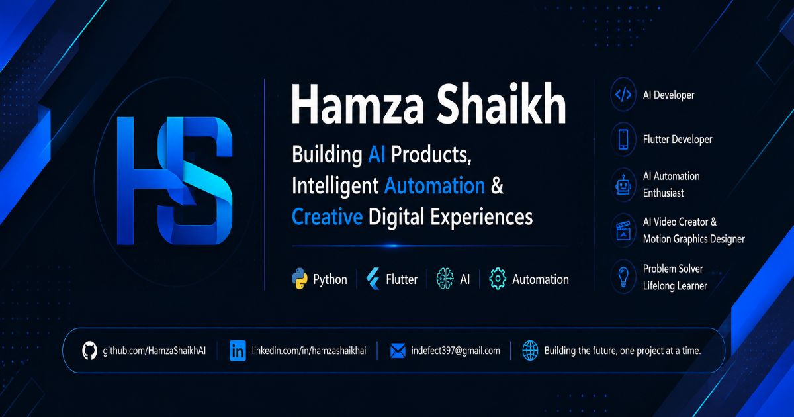

# Hamza Shaikh (@HamzaShaikhAI)

### Software Developer · AI Applications · Systems Engineering · Open Source

Building practical software through architecture, experimentation, implementation, testing, and documentation.

---

## 👋 About This Site

This repository contains the source for my personal developer portfolio, published with **GitHub Pages**.

The site introduces my software engineering interests, highlights selected open-source projects, documents technologies I explore, and provides links to my developer profiles.

**Live portfolio:** https://hamzashaikhai.github.io/

## 🚀 Featured Projects

### [KeplerBridge](https://github.com/HamzaShaikhAI/KeplerBridge)
**Direct3D 12 → Direct3D 11 compatibility and translation layer**

An experimental C++20 project investigating bounded DXIL-to-DXBC shader translation and a Direct3D 11 execution backend for legacy NVIDIA Kepler hardware.

- C++20 · Direct3D 12 · Direct3D 11 · DXIL · DXBC
- [Repository](https://github.com/HamzaShaikhAI/KeplerBridge)
- [v0.5.0-rc1 public release candidate](https://github.com/HamzaShaikhAI/KeplerBridge/releases/tag/v0.5.0-rc1)

*Release-candidate software with limited, workload-dependent compatibility. It is not a universal DirectX 12 solution.*

### [AgentForge](https://github.com/HamzaShaikhAI/AgentForge)
**Local-first AI agent integration and workflow platform**

A TypeScript and Node.js project for Google Antigravity, with MCP connectivity, permission-controlled execution, approval checkpoints, and local-first credential handling.

### [Notion Block Engine](https://github.com/HamzaShaikhAI/notion-block-engine)
**Zero-dependency TypeScript content conversion engine**

A library exploring bidirectional conversion between Markdown, HTML, clipboard content, and a Notion-style Block AST.

### [VYDRIX](https://github.com/HamzaShaikhAI/VYDRIX)
**Archived Windows cloud-backed virtual storage experiment**

Discontinued and retained as a technical reference and post-mortem.

## 🧰 Technologies & Interests

| Area | Technologies |
|---|---|
| Languages | C++20, Python, TypeScript, JavaScript, Dart, C# |
| Application development | Flutter, Node.js, .NET, Firebase |
| AI & automation | LLM integrations, AI agents, MCP, Ollama, workflow automation |
| Systems & graphics | Windows development, Direct3D 11/12, DXIL, DXBC, CMake |
| Engineering | Software architecture, compiler concepts, testing, Git, GitHub |

These are technologies explored across projects; this list is not a claim of equal proficiency in every tool.

## 🌱 Other Work

- **Hifz Hero** — in-development Flutter application for Quran memorization, revision, progress tracking, and offline-first learning.
- **VisionAI** — experimental computer-vision and Raspberry Pi assistant project.
- **PS-O1** — personal assistant project exploring local LLMs, multilingual interaction, and voice workflows.
- **AI Creative Studio** — experiments with AI-generated video and digital content.

## 🔗 Connect

- **Portfolio:** https://hamzashaikhai.github.io/
- **GitHub:** https://github.com/HamzaShaikhAI
- **LinkedIn:** https://www.linkedin.com/in/hamzashaikhai/

---

*Build with curiosity. Engineer with discipline. Improve through experimentation.*

